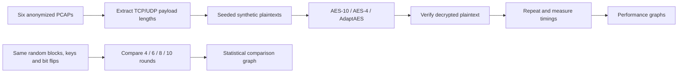
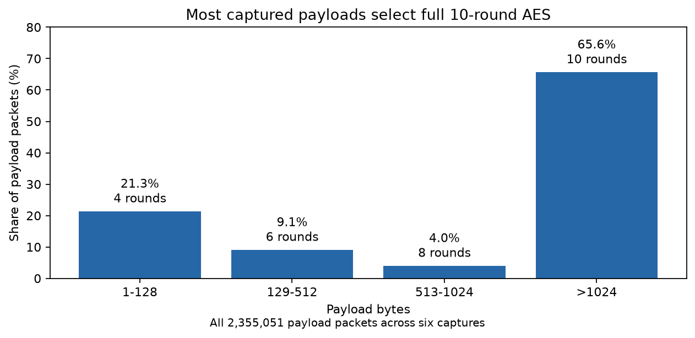
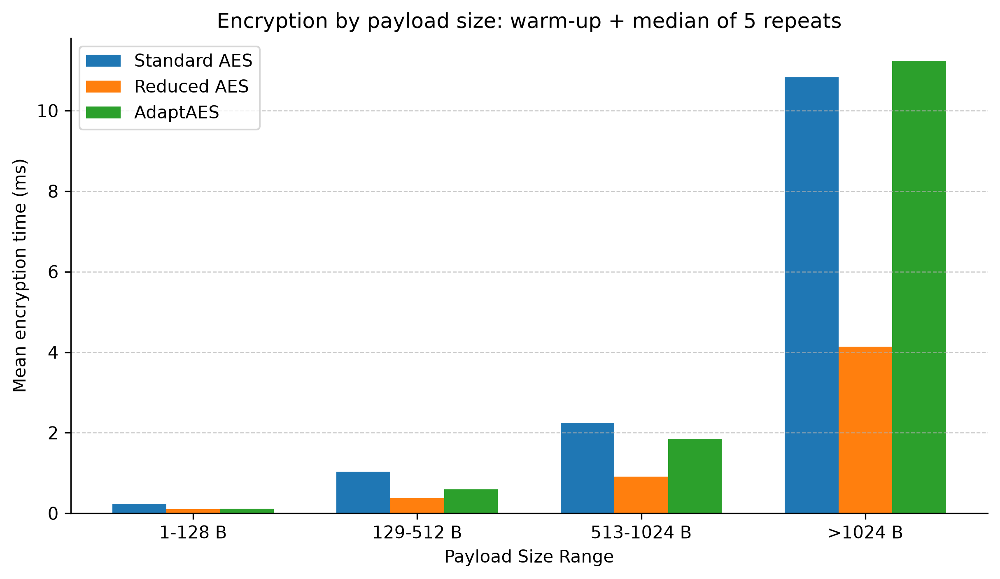
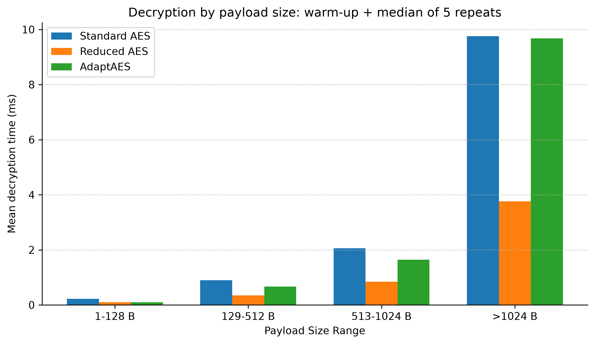
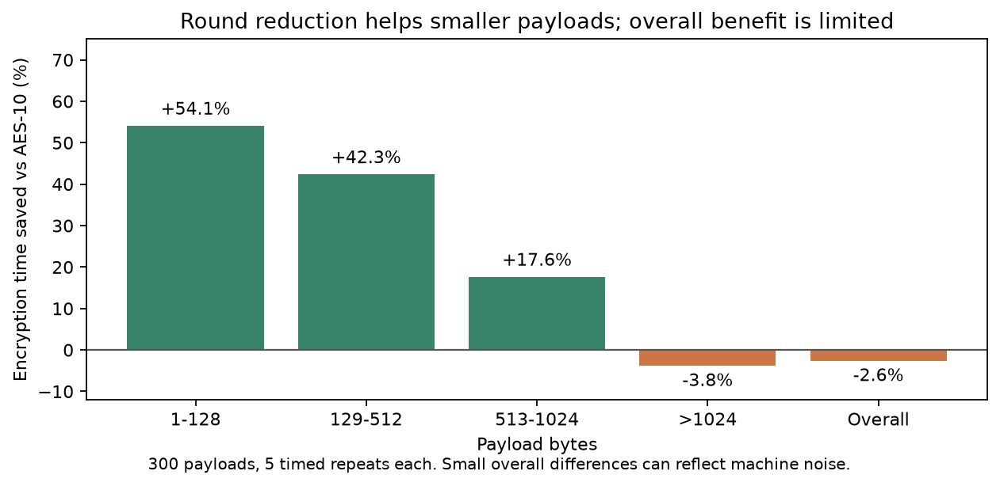
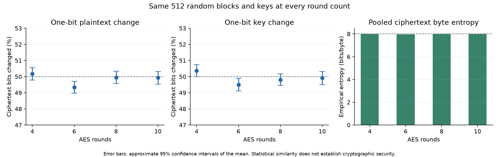
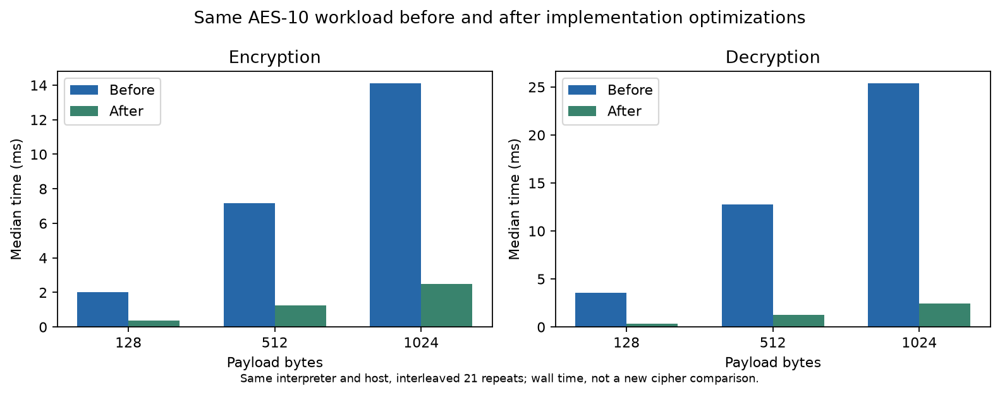

# AdaptAES: a five-minute project walkthrough

AdaptAES asks a small, testable question: how much time can we save by choosing
AES rounds from a packet's payload size, and how do the resulting ciphertext
statistics compare with full AES-128?

The deliverable is a Python experiment with reproducible inputs, working
encryption and decryption, measured results, and graphs. The size thresholds
are an experimental policy, not a security rating for different packet sizes.

## 1. Explain the experiment



The original packet contents are unavailable. We preserve their lengths and
supply deterministic random bytes of those lengths. The separate block
comparison holds inputs and keys constant across round counts.

| Method | What changes? | Why include it? |
|---|---|---|
| Standard AES-128 | Always 10 rounds | Correctness and timing baseline |
| Fixed reduced AES | Always 4 rounds | Fastest reduced-round comparison |
| AdaptAES | 4, 6, 8, or 10 rounds | Test the packet-size policy |

| Original payload bytes | 1–128 | 129–512 | 513–1024 | Above 1024 |
|---|---:|---:|---:|---:|
| AdaptAES rounds | 4 | 6 | 8 | 10 |

Round selection uses the original length, before PKCS#7 padding. Decryption
uses that same original length to select the same rounds.

## 2. Start with the traffic distribution



About two thirds of payload packets fall above 1,024 bytes and therefore use
all 10 rounds. That explains why a large speedup for small packets does not
translate into a large overall speedup. Large payloads also contain more blocks
and account for more encryption work.

## 3. Show the performance comparison





Read each group as the same payload-size range under the three methods. For
each payload and method, the runner warms up once, rotates method order, and
records the median of five timed repetitions. It verifies every decrypted
result. The bars average those per-payload medians within each range.



Positive values mean less encryption time than AES-10. The recorded run saves
about 54%, 42%, and 18% in the three reduced-round ranges. Overall AdaptAES was
about 2.6% slower in this run. Most work still uses 10 rounds, and small overall
differences can reflect machine noise. We should present this result rather
than promise a universal speedup.

## 4. Demonstrate statistical similarity



Each round count sees the same 512 independent random plaintext blocks and
keys. The same randomly selected plaintext bit and key bit are flipped for
each matched sample. This avoids comparing different input populations or
counting an identical AES-4/AdaptAES measurement twice as independent evidence.

| Measurement | How to explain it | What to look for |
|---|---|---|
| Plaintext avalanche | Flip one of 128 plaintext bits and count changed ciphertext bits | Approximately half, or 64 bits |
| Key avalanche | Flip one key bit and repeat | Approximately half again |
| Pooled byte entropy | Count byte values across all 512 ciphertext blocks | Close to the byte maximum of 8 bits |
| Error bars | Uncertainty in the measured average avalanche | Approximate 95% intervals across independent samples |

The entropy calculation pools 8,192 ciphertext bytes per round count. Older
analysis in `results/analysis/` averages entropy over individual 16-byte blocks,
where the empirical maximum is 4. Those values answer a different question and
should not be compared directly with the new pooled entropy.

Individual means and intervals need not include exactly 50%. In this seeded
run, the six-round plaintext mean is about 49.34%. The comparison is descriptive;
it is not a formal statistical equivalence test.

A defensible sentence for the viva is:

> In these matched-input tests, reduced-round configurations have avalanche
> averages near 50% and pooled byte entropy near full AES. This demonstrates
> similar behavior in the selected statistical measurements. It does not
> establish equal resistance to cryptanalytic attacks.

The implementation encrypts blocks independently. It has no authentication or
network protocol and is a lab experiment. Ciphertext that passes these tests
can still have weaknesses that the tests do not measure.

## 5. Separate cipher policy from code optimization



This graph holds the cipher at 10 rounds on both sides. The implementation now
looks up fixed finite-field products and expands a key once per payload instead
of once per block. The statistical analysis also reuses identical measurements
when two methods choose the same round count.

| AES-10 workload | Before | After | Measured speedup |
|---|---:|---:|---:|
| Encrypt 1,024 bytes | 14.09 ms | 2.49 ms | 5.67× |
| Decrypt 1,024 bytes | 25.36 ms | 2.43 ms | 10.44× |

These are interleaved medians of 21 repetitions on one machine, using the same
Python 3.14.8 interpreter. CPU timings are recorded alongside wall timings in
[`comparison.json`](../results/runtime/comparison.json). Interpreter launch and
module execution were measured separately at 18.76 ms before and 19.46 ms after.
The optimization claim concerns the encryption workload, not startup or package
installation. Other machines will produce different absolute timings.

## Know which population each result describes

| Stage | Coverage | Evidence |
|---|---:|---|
| Capture extraction | 4,587,976 packets; 2,355,051 nonempty payloads | `results/extracted/` |
| Deterministic generation | 5,000 per capture; 30,000 total | `results/payloads/` summaries and hashes |
| Classroom timing | 50 per capture; 300 total, all three methods | `results/classroom/timings/` |
| Matched block comparison | 512 independent inputs, all four round counts | `results/comparison/` |
| Original payload statistical analysis | 30,000 payloads, first block of each | `results/analysis/` |

Timing counts per size bucket are 53, 24, 19, and 204. These are a small lab
sample, particularly in the middle ranges. Equal sample counts per capture
also differ from weighting captures by their total traffic volume.

## Reproduce the classroom demo

Python 3.11+ and [uv](https://docs.astral.sh/uv/) are required. Only plotting needs
third-party dependencies; the cipher, tests, and timing runner use the standard
library.

```bash
uv sync --frozen --extra plots
uv run python -m unittest discover -s scripts -v
uv run python scripts/compare_rounds.py
uv run python scripts/generate_classroom_graphs.py
```

These commands use checked-in timing/runtime results and regenerate the graphs.
No raw PCAPs are needed. To rerun timings from the checked-in extracted lengths:

```bash
uv run python scripts/generate_plaintext_payloads.py \
  --input-dir results/extracted --out-dir results/payloads --sample-size 5000 --seed 42
uv run python scripts/validate_generated_payloads.py --payload-dir results/payloads
uv run python scripts/benchmark_dataset_timings.py \
  --payload-dir results/payloads --out-dir results/classroom/timings --limit 50 --repeats 5
uv run python scripts/generate_classroom_graphs.py
```

The generator's recorded hashes reproduce with seed 42. Timing values vary
with machine load. Generated binaries and manifests remain local.

To reproduce the implementation before/after measurement:

```bash
git show 3ff4a89:scripts/aes_core.py > /tmp/adaptaes-before.py
uv run python scripts/benchmark_runtime.py --baseline-core /tmp/adaptaes-before.py
uv run python scripts/generate_classroom_graphs.py
```

For the viva, show the flow diagram, traffic mix, timing savings, then the
matched-input comparison. Finish by explaining why favorable byte statistics
are useful evidence for this assignment but do not prove cipher security.
